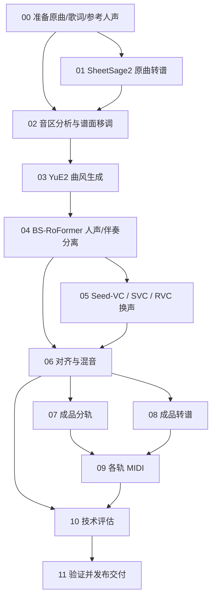

# 当前架构

控制器 `src/music_cover/pipeline.py` 解析任务，`engine.py` 管理阶段依赖、缓存、锁和交付。`modules/` 声明输入输出与参数，`backends/` 在各自 Python 进程中执行模型。

训练位于 `scripts/05_voice_conversion/<后端>/training/`，产出版本化 `voice.json`，05 只加载模型。保留 Seed-VC zero_shot 与 finetuned；SVC/RVC 需要歌手训练权重。单曲伪标签微调不属于当前支持路线。

| 层 | 职责 | 位置 |
|---|---|---|
| 入口 | 参数解析、预检、选择阶段、切换后端配置 | `pipeline.py`、`scripts/*/run.sh` |
| 编排 | 依赖、可追溯 attempt、缓存哈希、原子发布 | `engine.py` |
| 阶段 | 明确输入角色、参数、后端、输出角色 | `modules/` |
| 音色接口 | profile 类型、架构与权重一致性 | `voice.py`、`svc.py`、`rvc.py`、`common/voice_profiles.py` |
| 模型执行 | 重型库与上游命名空间隔离 | `backends/` |
| 训练 | 数据分组、特征、训练、验证、导出 | `voice_training.py`、`svc_training.py`、`rvc_training.py` |
| 验收 | 候选技术门槛、ECAPA/F0、交付完整性 | `voice_candidates.py`、`common/validation.py` |

RVC/SVC 共用现有 base；指标使用 Seed-VC 环境。其它阶段使用既有独立环境，不把所有模型包合并安装。每个后端只把自身的资源锁纳入阶段缓存，其他模型变化不应使无关阶段重跑。

同一 run 中切换后端会清除旧后端的私有配置和旧模型档案，需要显式指定新后端的模型。对照实验通过 `scripts/fork_voice_run.py` 复用 00–04；这些引用关系在清理数据时必须保留。

具体逐阶段命令及中间路径见 [使用说明](../USAGE.md)。最初设计另存 [历史架构](archive/01-architecture_before_cleanup_20261029.md)，其中旧文件名和未实施计划不作为当前接口。
