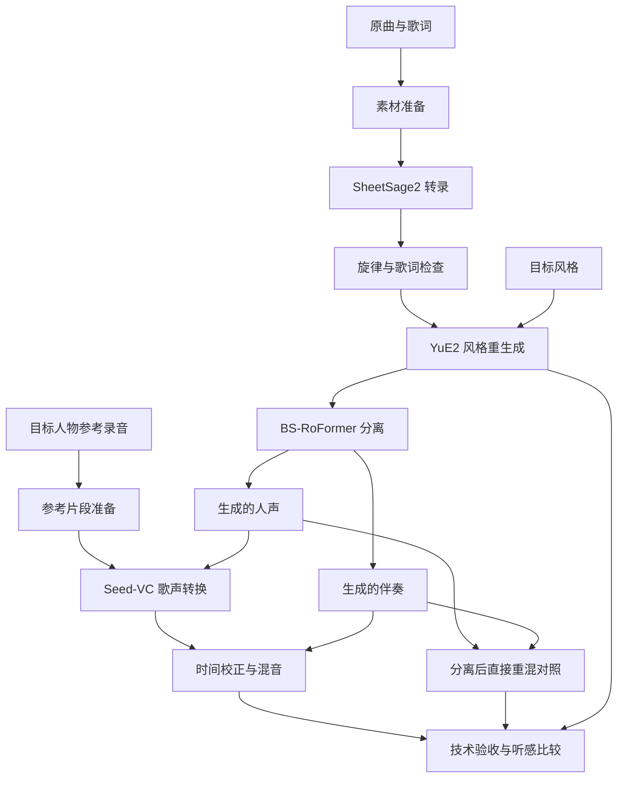

> 设计存档：本文件记录实施前的方案，部分环境、文件名和步骤已调整。当前使用方法以 [USAGE.md](../USAGE.md) 为准；实测版本见 `configs/environments.lock.json`，实测结果见运行目录的 `deliverables/report.md`。

项目采用文件衔接的离线流水线。每个模型在独立进程和环境中运行，项目层只负责输入准备、参数转换、调用、产物检查和实验记录。首版直接复用上游推理入口，减少同时排查模型问题和集成问题的成本。



YuE2 的官方 cover 路径先将原曲转录为 ABC 乐谱，再通过乐谱、歌词和目标风格生成新歌曲。默认采用 `cot=melody`，使旋律受约束、伴奏可以适配目标风格。这一步可能改变演唱时间和歌曲长度，因此后续分离、换声和混音统一依附生成歌曲的时间轴。[官方 Cover 指南](https://github.com/multimodal-art-projection/YuE/blob/main/docs/covers.md)

各阶段采用以下职责边界。阶段目录里的文件是未来运行产物，当前尚未生成。

| 阶段 | 输入 | 核心职责 | 标准产物 |
| --- | --- | --- | --- |
| 00_prepare | 原曲、歌词、参考录音 | 解码检查、整理歌词、选择参考片段、登记来源 | 准备后的素材清单、音频探测信息 |
| 01_transcribe | 准备后的原曲 | 调用 SheetSage2、检查 ABC、保存诊断 | score.abc、transcription.json |
| 02_cover | 选定 ABC、歌词、风格、随机种子 | 调用 YuE2、检查完整性 | restyled.flac、上游生成产物、generation.json |
| 03_separate | restyled.flac | 双轨分离、记录增益处理与时间信息 | vocals.wav、instrumental.wav、separation.json |
| 04_convert | 生成的人声、参考片段 | 单声道输入准备、Seed-VC 推理、记录分块信息 | converted.wav、conversion.json |
| 05_mix | 生成的人声、转换人声、生成的伴奏 | 对齐、统一采样率、直接重混对照和最终混音 | reconstruction.wav、final.wav、alignment.json、mix.json |
| 06_evaluate | 全部关键音频与运行记录 | 文件检查、指标、听感记录 | metrics.json、listening.md、report.md |

参考录音的分离属于 00_prepare 的条件分支，仅在参考音频含伴奏或其他人声时启用。该分支可以复用同一分离适配器，但产物属于 reference 时间轴，不能与 cover 时间轴混用。

另设 `mode=vc_probe` 的短段实验：从原曲抽取 20–30 秒人声，验证参考音色能否用于歌声转换。探针目录与正式 cover 目录分开；探针不证明 YuE2 的效果，也不代替最终使用 YuE2 人声的实验。

未来实现时建议采用以下代码结构；这些源码目录和文件本轮不创建。

```text
src/music_cover/
├── cli.py                    # preflight、run、resume、inspect 入口
├── config.py                 # 请求校验、默认值、配置解析
├── orchestrator.py           # 阶段依赖、检查点、恢复和重跑
├── artifacts.py              # 路径、哈希、原子提交、状态记录
├── audio.py                  # 探测、重采样、声道、时间轴、混音
├── evaluation.py             # 技术检查与评价数据导出
└── adapters/
    ├── base.py               # 准备调用、执行、收集产物的统一接口
    ├── sheetsage2.py
    ├── yue2.py
    ├── separator.py
    └── seed_vc.py
tests/                        # 时间轴、缓存恢复、输入校验等关键测试
scripts/                      # 后续确有重复操作时再添加运行辅助入口
```

调度器不直接导入各模型的深度学习依赖。适配器接收项目级请求，生成该上游需要的输入文件，通过指定环境的 Python 或 CLI 执行，再把上游输出映射为标准产物。程序调用使用参数列表，避免将风格描述、歌词或文件路径拼接成 shell 命令。

首版每次只启动一个 GPU 阶段。各模型子进程退出后，下一阶段再使用 GPU；CPU 音频检查和文档生成不持有模型。运行时显式选择 GPU，记录物理 GPU UUID 以及进程内设备编号。

未来每次运行采用以下目录，`attempt_001` 表示阶段的一次执行尝试。

```text
runs/<run_id>/
├── request.json              # 用户请求快照
├── resolved.json             # 展开默认值后的配置、环境与模型身份
├── manifest.json             # 已选定产物、依赖、哈希与时间轴
├── stage_state.json          # 阶段执行状态与当前尝试
├── reviews/                  # 旋律、生成、换声和混音的人工判断
├── 00_prepare/attempt_001/
├── 01_transcribe/attempt_001/
├── 02_cover/attempt_001/
├── 03_separate/attempt_001/
├── 04_convert/attempt_001/
├── 05_mix/attempt_001/
└── 06_evaluate/attempt_001/
```

每个 attempt 内保存自己的 `stdout.log`、`stderr.log`、调用参数、开始结束时间和校验结果。失败后的新尝试使用新目录，保留旧日志；人工改谱也保存新的 ABC，不覆盖转录原件。

修改输入后，重跑范围按依赖决定。

| 修改项 | 最早受影响的位置 | 可以复用的内容 |
| --- | --- | --- |
| 原曲文件或原曲预处理 | 00_prepare 的原曲分支 | 未改变的参考音频准备结果 |
| 旋律 ABC | 02_cover | 原始音频、已完成转录和参考素材 |
| 歌词、目标风格、YuE2 随机种子 | 02_cover | 转录结果；歌词结构改变时需重新核对谱词对应 |
| 分离模型或分离参数 | 03_separate | YuE2 生成结果 |
| 参考片段或参考清理参数 | 00_prepare 的参考分支、04_convert | 转录、YuE2、生成歌曲的双轨分离 |
| Seed-VC 参数或权重 | 04_convert | 生成歌曲及分离结果 |
| 对齐、增益或混音参数 | 05_mix | 已转换的人声 |
| 评价规则 | 06_evaluate | 所有音频产物 |

RVC 与 so-vits-svc 后续可以作为额外适配器接入，但其请求必须包含目标音色模型及配套配置。只有参考音频时，应在参数校验阶段明确提示输入不满足要求，不能静默切换成其他音色。
