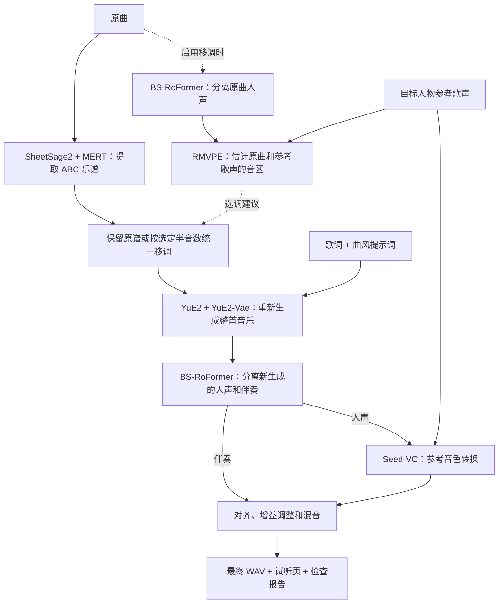

音乐换曲风与参考音色转换 Baseline 技术报告（2026-10-22）

当前项目已经跑通“原曲转谱 → 按目标曲风重新生成 → 分离人声与伴奏 → 参考歌声换音色 → 对齐混音”的完整流程，并加入了可选的音区分析与谱面移调。核心生成模型为 YuE2，换声模型为 Seed-VC；使用现成预训练权重，不需要针对目标人物另行训练。

本报告依据当前代码、锁定的模型配置以及已完成运行的产物整理。这里的“跑通”表示推理和工程检查成功；曲风符合程度、歌词准确度、目标音色相似度和自然度仍需听感验收。本次报告整理未重新生成音频，也未进行人工听感验收。

项目位于 `/data/liuhongda/music-cover-baseline`，统一入口是 `scripts/run_baseline.sh`，操作方法见 [USAGE.md](../USAGE.md)。

完整路线如下，其中音区分析和谱面移调仅在启用 `--transpose` 时执行：

各模型在当前实现中的作用如下：

| 模型或权重 | 当前用途 | 输出或作用 |
| --- | --- | --- |
| MERT-v2-FullSong | SheetSage2 的音乐特征编码器 | 从原曲提取音乐表征 |
| SheetSage2 | 音频转谱 | 为 YuE2 提供 ABC 格式的旋律条件 |
| YuE2-3B | 按乐谱、歌词和风格提示词生成音乐 | 重新生成目标曲风的演唱和编曲 |
| YuE2-Vae | YuE2 音频解码器 | 将生成的声学表示解码为音频 |
| BS-RoFormer | 音源分离 | 分离人声与伴奏；启用选调时也用于分离原曲人声 |
| Seed-VC，44.1 kHz、F0 条件歌唱转换权重 | 参考录音驱动的零样本换声 | 将新生成的演唱转换为接近参考人物的音色 |
| RMVPE | 基频 F0 提取 | 用于音区分析、Seed-VC 音高条件及结果检查 |
| Whisper-small 编码器 | Seed-VC 内容编码 | 提取待转换歌声的内容表征；主流程中不负责准备歌词 |
| CAMPPlus | Seed-VC 参考音色编码 | 从参考录音提取说话人/音色表征 |
| BigVGAN v2，44.1 kHz | Seed-VC 声码器 | 将预测的声学特征转换为人声音频 |

当前分离权重为 `model_bs_roformer_ep_317_sdr_12.9755.ckpt`。Seed-VC 歌唱权重为 `DiT_seed_v2_uvit_whisper_base_f0_44k_bigvgan_pruned_ft_ema_v2.pth`；实际本地内容编码配置使用 Whisper-small，不能仅依据权重文件名判断辅助模型版本。FFmpeg 用于音频解码、裁剪和重采样，不是生成模型。

模型来源及 revision 记录在 [generation_models.lock.json](../configs/generation_models.lock.json)、[voice_models.lock.json](../configs/voice_models.lock.json) 和 [separation_model.lock.json](../configs/separation_model.lock.json)。上游路线说明可参考 [YuE 官方仓库](https://github.com/multimodal-art-projection/YuE) 与 [Seed-VC 官方仓库](https://github.com/Plachtaa/seed-vc)。

当前实现有三个关键设计选择。

第一，换曲风通过“乐谱作为中间表示”完成。SheetSage2 从原曲提取旋律谱，YuE2 接收该乐谱、歌词和新风格提示词，重新演唱并生成伴奏。当前使用旋律条件，给新编曲留下调整空间。因此它是受原曲旋律约束的重新生成，不能保证原曲波形、每个音符、演唱节奏和总时长完全不变。转谱误差也可能传递到生成阶段。对应实现见 [stage_runner.py](../scripts/stage_runner.py)。

第二，换音色采用参考录音驱动的 Seed-VC。用户没有目标人物的专用模型，因此当前没有接入最初考虑的 RVC / so-vits-svc，也没有调用 Suno。Seed-VC 使用通用预训练模型，结合参考音色、待转换内容和音高条件合成新歌声。当前使用 30 步推理，开启 F0 条件，长度系数为 1.0；关闭自动 F0 调整，额外半音偏移为 0。目标是尽量保持 YuE2 已生成的旋律与时间轴，再改变音色。

第三，导师提出的“先识别音区，再升调”已落实为可选模块。启用 `--transpose auto` 后，先分离原曲人声，再通过 RMVPE 统计原曲与参考歌声的基频分布，在 0～6 个半音中选取整体升调量。评分兼顾低音区匹配、高音过高惩罚和移调幅度；参考高音之外的 5 个半音余量是实验参数。该方法估计的是短参考片段的歌声音区，不代表歌手的完整生理音域。手动模式支持 -12～12 个半音，默认不移调。

移调在 YuE2 生成之前修改乐谱，统一调整人声及器乐旋律声部、调号，并检查音符起点、时值、节拍和速度保持不变。YuE2 据此生成同调的演唱和伴奏，随后 Seed-VC 不再额外移调。当前自动策略可能选择 0；它不是每首男声歌曲都固定升调。实现见 [pitch.py](../src/music_cover/pitch.py)。

运行需要的输入及现有素材如下：

| 输入 | 项目位置 | 当前要求或状态 |
| --- | --- | --- |
| 原曲 | `data/raw/songs/` | 已有《落叶归根》《秋意浓》等测试素材 |
| 歌词 | `data/raw/lyrics/` | UTF-8 文本，可接受 LRC；歌词顺序应与歌曲匹配 |
| 参考录音 | `data/raw/references/` | 建议单人、清晰的 10～20 秒歌声 |
| 风格描述 | 命令行 `--style` | 描述曲风、乐器、节奏及演唱方式 |

当前孙燕姿参考是从歌曲中分离出的约 16 秒人声，路径为 `data/raw/references/sun_yanzi/reference.wav`。詹姆斯参考以说话为主，可以用于换声尝试，但不适合用来推断歌唱音区。主推理脚本只裁剪、重采样参考音频，不会自动给任意参考录音分离伴奏；新的带伴奏参考应先独立处理。

实际完成的两个代表性运行如下。目标音色一栏表示所用参考，曲风一栏表示生成目标，并不等同于已经通过人工验收。

| 原曲 | 目标曲风 / 参考音色 | 自动移调 | 最终时长 | 成功流程耗时 |
| --- | --- | --- | --- | --- |
| 《落叶归根》 | 现代爵士摇滚融合 / 孙燕姿歌声 | +3 半音，Ab → B | 307.28 秒，约 5 分 7 秒 | 262.84 秒，约 4 分 23 秒 |
| 《秋意浓》 | 乡村抒情 / 孙燕姿歌声 | 0 半音，Am → Am | 390.96 秒，约 6 分 31 秒 | 294.39 秒，约 4 分 54 秒 |

以上是本机单张 H200 按阶段串行推理的记录，包含阶段进程启动和模型加载，不含首次安装下载、先前失败尝试及附加评价。当前 YuE2 显存预算配置为 80 GiB，这不是实测峰值，也不构成最低硬件要求结论。

《落叶归根》移调前后，换声前歌声的全曲 F0 中位数由 236.75 Hz 变为 282.63 Hz，约提升 3.07 个半音；最终歌声 30～60 秒窗口的中位数由 165.21 Hz 变为 206.28 Hz，支持开头歌声音区上移。两次生成的节奏和时长不同，这些统计不能视为逐音移调精度，也不能证明粗糙感已经消除。详见 [升调运行报告](../runs/20261022_022204_luo_ye_gui_gen_sun_yanzi_pitch_adapted_15e6f1/deliverables/report.md)。

《秋意浓》已完成从转谱到混音的全部阶段。此前长曲生成截断的问题已通过按乐谱时长分配生成 token 上限处理，本次实际使用 12000 个语义 token 上限并正常结束；该上限提供约 8 分钟容量，不要求生成满 8 分钟。脚本仍会拒绝截断结果以及超出上下文容量的请求，不保证任意长度歌曲都能生成。详见 [秋意浓运行报告](../runs/20261022_024637_qiu_yi_nong_country_sun_yanzi_e60edb/deliverables/report.md) 和 [实际生成预算](../runs/20261022_024637_qiu_yi_nong_country_sun_yanzi_e60edb/02_cover/attempt_002/generation_budget.json)。

每次运行交付目录为 `runs/<运行编号>/deliverables/`。最终混入的是 YuE2 新生成并分离出的伴奏。混音前进行固定延迟校正、长度检查及增益调整，输出 48 kHz、立体声、24 bit WAV。

| 验收文件 | 用途 |
| --- | --- |
| `final.wav` | 最终音乐 |
| `listen.html` | 原曲、参考音色、中间结果和最终结果的试听入口 |
| `restyled.flac` | 先验收 YuE2 的旋律、歌词和风格 |
| `vocals_before.wav` / `vocals_after.wav` | 比较换声前后的人声 |
| `instrumental.wav` / `reconstruction.wav` | 检查伴奏及分离、重混损伤 |
| `report.md` / `checks.json` | 耗时、音频格式、长度、对齐、峰值等记录 |
| `transposition.json`、前后 ABC 谱和音高报告 | 启用移调时检查选调依据、谱面修改及实际音高 |

工程层面已经支持模型环境隔离、分阶段日志、输入和产物哈希、失败恢复，以及在依赖未变化时复用已完成阶段。模型与配置可追溯，但这些记录不能代替音乐质量评价。相关实现见 [pipeline.py](../src/music_cover/pipeline.py)。

目前仍有以下限制：

- 参考片段的音区、发声方式和清洁程度会影响换声。约 16 秒参考无法覆盖完整歌唱表现，音色相似度尚无统一验收结论。
- YuE2 是重新生成，可能改变演唱节奏、歌词和旋律细节；当前流程不保证逐词或逐音忠实。
- 分离可能残留原人声、和声或混响，这些成分贴回伴奏后会影响目标音色。
- 已有升调结果的前奏在换声后检测到少量新增有声帧，提示可能存在额外声响；升调模块没有解决无歌声段的换声噪音。
- 自动选调依赖短片段统计，当前只在“不变或升调”中选择；高音自然度和低音粗糙度仍需分别试听。
- 当前速度来自单机实测，缺少跨硬件性能评测及覆盖多首歌曲、多个目标人物的系统听感评价。

下一步可优先补充多个干净歌唱参考片段、处理无歌声区间的换声输出，并建立固定歌曲集的分阶段听感对照。这些是后续建议，尚未作为当前 baseline 的已实现能力。
