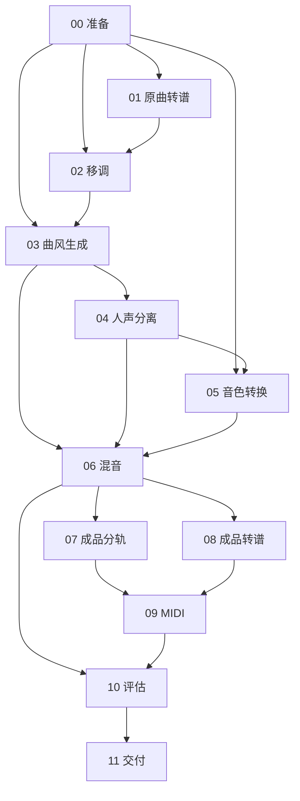

# 模块化 baseline：执行、产物契约与技术迭代

v0.2 基于 v0.1 重构，保留 SheetSage2、YuE2、BS-RoFormer、Seed-VC、Demucs、Basic Pitch 等现有模型；02 的选调现已升级为[双向算法](10_bidirectional_pitch.md)。目标是使每个阶段可独立执行、检查、替换和重跑，不改变“原曲 → 改曲风 → 换音色 → 评审”的技术路线。默认主流程串行执行；目录编号是阅读顺序，真实依赖由模块声明。

可直接复制的完整 00–11 示例、输入来源和结果路径见 [实操手册](11_modular_walkthrough.md)。

## 目录与职责

```text
scripts/
  run_baseline.sh            # 总入口，兼容原有歌曲/音色/曲风参数
  00_prepare/run.sh          # 每个阶段都有 run.sh 和 README.md
  01_source_score/run.sh
  02_pitch_adaptation/run.sh
  03_style_generation/run.sh
  04_vocal_separation/run.sh
  05_voice_conversion/run.sh
  06_mix/run.sh
  07_stem_separation/run.sh
  08_final_score/run.sh
  09_stem_midi/run.sh
  10_evaluation/run.sh
  11_delivery/run.sh
  setup/                     # 下载、环境记录、演示素材准备
  verify_review.py           # 独立检查完整交付，兼容历史 v0.1
src/music_cover/
  pipeline.py                # 参数和任务配置，选择执行范围
  engine.py                  # 依赖解析、运行锁、缓存、attempt 和原子发布
  modules/                   # 12 个模块的业务逻辑、输入角色和参数
  backends/                  # 按模型/功能拆开的独立进程适配
  common/                    # JSON、歌词、资产、校验和打包公共能力
  audio.py, pitch.py         # 音频处理和谱面移调公共算法
  pitch_selection.py         # 双向候选评分、参考质量、报告和输入谱 MIDI
  pitch_validation.py        # 生成/换声实测音高核验
configs/
  pipeline.yaml
  modules/*.yaml
  tasks/qiu_yi_nong_synthwave_sun_yanzi.yaml
```

`run.sh` 只是稳定入口。修改算法应改对应 `modules/*.py` 或 `backends/*.py`，无需复制上游模型代码。不同模块可复用同一个后端，例如原曲与成品转谱都使用 SheetSage2。重构后的 `review.py` 和 `scripts/stage_runner.py` 仅保留兼容导入/调用。

## 每个模块的输入和产物

下表文件均位于本模块的 `attempt_NNN/artifacts/` 下。每次尝试保留完整目录，下游读取成功清单中的确切路径，不通过 `glob` 猜“最新文件”。

| 模块 | 输入来源 | 主要产物 / 检查点 |
| --- | --- | --- |
| 00_prepare | 原曲、歌词、参考音频 | `source.wav`（48k 立体声）、`reference.wav`（44.1k 单声道裁剪）、`lyrics.txt`、`metadata.json` |
| 01_source_score | 00 的原曲 | `score.abc`、`events.json`、原曲 MIDI / 拍点等原生转谱数据；ABC 必须包含声部 |
| 02_pitch_adaptation | 01 的 ABC；非零或 auto 时还使用 00 原曲和参考 | `score_original.abc`、`score_transposed.abc`、`transposition.json`、`score_transposed.mid`、候选 CSV/HTML、谱/音频一致性 JSON；启用时包含原曲分离结果、F0 和音区分析。`0` 明确记录直通，不加载分离/F0 模型 |
| 03_style_generation | 02 的乐谱、00 歌词、style / seed | `generated/audio.flac`、生成请求、长度预算及原生模型数据；截断生成拒绝通过 |
| 04_vocal_separation | 03 生成的歌曲 | `vocals.wav`、`instrumental.wav`（模型原生 44.1k） |
| 05_voice_conversion | 04 人声、00 参考、steps / seed | `converted.wav`、实际单声道输入；保留原有 Seed-VC 参数 |
| 06_mix | 03 原混音、04 人声和伴奏、05 换声 | `final.wav`、`final.mp3`、`mix.json`、对齐人声、直接重混对照；新增 `vocal_post_gain.wav`、`instrumental_post_gain.wav`、`mix_residual.wav` 记录实际入混音成分 |
| 07_stem_separation | 06 最终音频与增益/对齐结果、04 伴奏 | `stems.json`、`audio/*.wav`、重建对照；12 条父/子/残差轨中只有指定 10 条叶轨相加 |
| 08_final_score | 06 最终音频 | 成品完整转谱、`chords.mid`、`transcription_summary.json`；使用成品而非原曲时间轴 |
| 09_stem_midi | 07 全部分轨、08 和弦 MIDI | `midi/*.mid`、`notes/*.csv`、`raw_midi/`、`activations/`、`midi.json`；主 MIDI 使用绝对秒时间 |
| 10_evaluation | 原曲、02 计划/F0、06 混音；启用 review 时含 07–09 | `evaluation.json`、音频描述性指标、分轨重建/MIDI合法性检查；启用移调时默认加生成遵循/换声保持检查 `pitch_adherence.json` |
| 11_delivery | 已成功的 00–10 所需产物 | 完整音频、试听页、评审包、MIDI ZIP、配置副本、`delivery_validation.json`；全部校验后才发布 `deliverables` |



`--no-review` 跳过 07、08、09；10 仍做基础音频评估，11 仍交付 WAV/MP3。完整依赖以各模块的 `requires()` 为准。人工听评、歌词诊断或人工修谱没有伪装成自动通过项目。

## 使用方式

以下命令从项目根目录执行；路径在配置中也按项目根目录解释。

```bash
cd /data/liuhongda/music-cover-baseline
export PATH="/opt/conda/bin:$PATH"

# 直接完整执行，会自动创建新运行目录
bash scripts/run_baseline.sh \
  --config configs/tasks/qiu_yi_nong_synthwave_sun_yanzi.yaml

# 先看执行计划或检查环境，不生成音乐
bash scripts/run_baseline.sh --plan
bash scripts/09_stem_midi/run.sh --preflight

# 先做到混音，得到各阶段中间产物
bash scripts/run_baseline.sh \
  --config configs/tasks/qiu_yi_nong_synthwave_sun_yanzi.yaml \
  --run runs/my_modular_test --until 06_mix

# 稍后从分轨继续，只校验并复用之前的结果
bash scripts/run_baseline.sh --run runs/my_modular_test --from 07_stem_separation

# 只执行 MIDI 模块（上游必须已经成功且仍有效）
bash scripts/09_stem_midi/run.sh --run runs/my_modular_test

# 强制该模块创建一个新 attempt；不会偷偷重算其他模块
bash scripts/09_stem_midi/run.sh --run runs/my_modular_test --force

# 修改算法或参数后，从 MIDI 继续评估和交付
bash scripts/run_baseline.sh --run runs/my_modular_test --from 09_stem_midi

# 查看状态；完整交付后独立验收
bash scripts/run_baseline.sh --run runs/my_modular_test --status
PYTHONPATH=src envs/separator/bin/python scripts/verify_review.py runs/my_modular_test
```

也可以手动按顺序调用每个子目录的 `run.sh`，都传入同一个 `--run`。第一次执行 00 时提供任务配置；后续从运行目录读取已保存的请求与模块配置。

不提供 `--force` 时，单模块入口也会复用本模块已有有效结果。`--from` 表示“允许从这里开始计算”，并不强制全部重跑。需要保证早期依赖未失效；若更换了参考录音却从 09 开始，会报出最早失效的模块，提示从那个模块继续。

`--resume` 是 `--run` 的兼容别名，仅接受新的模块化运行。原有不带运行目录的长命令保持可用。**历史 v0.1 运行保留原布局，可继续用独立验证器读取，但不直接作为模块化运行续跑。** 这是为了避免重写旧目录和混淆旧、新契约；新执行请选新目录。

## 配置与替换模型

新运行的配置优先级为：代码默认值 → `configs/pipeline.yaml` 与 `configs/modules/*.yaml` → 任务 YAML → 命令行参数。续跑先读取运行内保存的请求和模块配置，再应用显式任务 YAML 和命令行覆盖。直接修改默认配置不会悄悄改变已有运行。

任务文件包含 `request` 与可选 `modules`。例如，只调整 MIDI 检出阈值的配置：

```yaml
modules:
  09_stem_midi:
    onset_threshold: 0.55
    frame_threshold: 0.35
    minimum_note_ms: 100
```

保存为 `configs/tasks/midi_tuning.yaml` 后：

```bash
bash scripts/run_baseline.sh --run runs/my_modular_test \
  --config configs/tasks/midi_tuning.yaml --from 09_stem_midi
```

09–11 会根据实际输入变化执行；前面的生成、换声和分轨可以复用。当前开放的模块参数包括执行超时、MP3 码率、MIDI 阈值及评估的 F0 检查开关；模型默认采样率等契约保持固定，未知参数会报错，避免“配置了但没有生效”。

替换算法时保留模块的产物角色和格式契约；如改变接口，在对应模块声明或提升 `CONTRACT_VERSION`（默认 1），并更新对应下游；每个模块的契约版本独立。替换权重、环境包或上游代码后，更新对应模型/环境锁记录。模型身份使用分组后的 revision/资产哈希清单，环境使用相应 installed 锁文件；没有把整个 Git commit 或全项目源码哈希塞入每个模块。锁文件必须与实际安装对应，不应原地替换权重而继续沿用旧锁。

## 运行目录与成功语义

```text
runs/<run>/
  request.json
  config.resolved.json
  stage_state.json
  manifest.json
  executions/<每次调用>.json
  stages/09_stem_midi/attempt_001/
    inputs.json              # 输入文件哈希、生产模块、确切 attempt
    config.json              # 生效参数、相关源码和模型/环境身份
    command.json             # 主入口与后端命令
    process.log
    checks.json
    outputs.json             # 校验通过后写入，成功产物清单
    result.json
    artifacts/...
  deliverables -> stages/11_delivery/attempt_001/artifacts
  reviews/review_scores.csv   # 人工填写区域，重跑不覆盖
```

- `partial`：指定阶段已完成，但尚未交付整条流程。中间产物可以检查和消费。
- `completed`：11 的包、哈希、音频、分轨、MIDI、ZIP 和页面链接检查均通过，并发布交付入口。
- `failed`：错误和日志保留；没有成功清单的 attempt 不能被下游消费。

每次执行只接受显式依赖的成功产物。缓存同时检查输入哈希、相关参数、模块及其声明的代码依赖、模型/环境锁，以及所有输出文件。任一输出损坏都不会静默复用；无需重算的模块会打印 `[reuse]`。

`deliverables` 为相对符号链接，指向已验证的不可变 attempt，避免再复制一套大体积分轨。下载时读取链接中的文件即可。开始局部修改后，原交付仍保留，但 `delivery_status=pending`，不能当作当前参数的新结果；新交付通过后才原子切换。各历史 attempt 不删除。

音频时间轴分为原曲、参考片段、生成歌曲三种。不要把原曲某一秒与成品同一秒当作音乐位置对齐。最终混音与评审分轨统一为 48k、同起点同长度；模型内部输入保留各自所需采样率。MIDI 的固定 120 BPM 是秒时间刻度，不是实测歌曲速度。

这次模块化提供的是技术阶段重跑。它没有新增副歌局部重生成、人工修改 MIDI 后重新合成、DAW 编辑或客观音乐质量保证。
