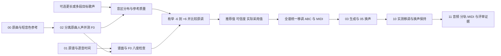

# 双向选调 v2：证据、执行和验收

2026-10-23 实现。阶段仍为 02，03 继续消费 `score_transposed.abc`，05 保持 F0 条件且额外半音偏移为 0。原有运行目录不迁移、不覆盖；算法/契约升级会使旧 02 及下游缓存失效，重新执行会创建新 attempt。

## 数据流



## 算法和边界

1. RMVPE 提供原曲人声、参考人声的 10 ms F0。新分析器过滤非有限值、50–1100 Hz 外帧、相对 RMS 门限以下帧，以及孤立八度尖峰；不平滑掉正常颤音。它没有使用模型未提供的“逐帧置信度”。
2. 对有效帧按持续时间统计 P10～P90 的 81 个分位数；每段额外参考文件等权，避免长文件完全支配其他文件。若未提供 `range_references`，用 00 的短参考。范围参考应为干净的目标人物独唱歌声，额外文件不自动做人声分离。
3. 默认整数候选 `-6..+6`；可配置到 `-12..+12`，必须包含 0。候选评分 `mean(abs(Q_source + k - Q_reference)) + 0.04*k²`，是截取中部的分位数 L1 距离。完整定义和候选分量保存为 JSON/CSV。不使用旧版“参考 P95 + 5”推断硬上限。
4. 如有人工确认的目标音域，可提供 `target_low_midi` 和 `target_high_midi`，评分额外加入所有有效源帧超界量的平均值 × `range_penalty`。它是软惩罚，不保证每个音都在范围内。
5. 每个合格参考至少 3 秒有效有声；4 秒时间块（至少 0.5 秒有声）重采样 128 次，固定随机种子以便复现。每个参考至少 2 个有效块；自动非零采用要求方向支持 ≥0.60 且相对 0 评分改善 ≥0.15。也报告 ±1 半音稳定率和第二候选分差，不把方向稳定误称为精确半音数确定。
6. `reference_kind` 默认 unknown；只有明确的 singing 才自动采用非零推荐。speech/unknown、数据不足、方向不稳定或改善过小，会保留原调并给出原因。`recommended_semitones` 可非零而 `applied_semitones` 为 0，避免把兜底误写成“成功匹配”。手动非零覆盖这些统计门限。
7. 信心为工程分级，不是校准概率。有效歌声累计 ≥20 秒、方向支持 ≥0.90、±1 半音稳定率 ≥0.80 可标 high，其余满足采用条件标 medium；谱/音频不一致会把 high 降为 medium。该方法适配参考片段所体现的音区，不能声称识别了歌手完整音域或生理舒适区。

`transpose=0` 保持不加载分析模型的直通行为，不产生上述分析报告。`auto` 选到 0 则仍保存全部分析证据。旧 `pitch.choose_transposition` 保留为历史 v1 兼容函数与旧测试，生产 02 已改用 `pitch_selection.choose`；不会调用旧的单向策略。

## 谱面、MIDI 和八度问题

对人声/器乐旋律、调号及和弦标记做同一个整数 k 的移调，并逐事件检查音高差、起点、时值、节拍和速度。`score_transposed.mid` 使用原谱速度，包含 Vocal/Ins 两条旋律轨；和弦标记没有展开成完整伴奏。成品重新转谱 MIDI 仍在 09，不混用两个时间轴。

01 的 `melody_vocal.lab` 与原曲 F0 按原始秒时间逐音比较，去掉各音两端 10%。至少 10 个匹配音后，报告中位差、最近整八度及其 ±1 半音支持率。现有两首歌的谱面比 F0 约高一八度，但历史生成音频接近原曲音区；因此不据此直接再降 12 半音。八度问题是转谱与生成控制的独立风险，记录证据后由音频核验检查。

## 生成后核验

10 将原曲与生成 F0 聚合为 0.2 秒有声片段，按减去各自中位数后的相对轮廓做带约束 DTW。对齐不使用要求的 k，不按音高类别折叠八度。然后在绝对 MIDI 音高上检查观测移调量、±1 半音覆盖率、偏差及八度错误。换声前后使用延迟校正后的同时间片段检查，期望额外变化为 0。

默认至少 30 个匹配片段、覆盖 ≥0.60、差值中位绝对偏差 ≤1.5 半音才可判定；期望值与实测中位差 ≤0.5 且 ±1 半音比例 ≥0.60 才标 verified。声段长度比超出 0.5..2 则不可判定。DTW 可能掩盖漏唱和结构变化，不能替代歌词、逐音和听感检查。`unassessable` / `needs_review` 不会被改写成技术流程失败，也不会触发隐式音频移调；它们随交付保留给评审者。

## 可直接运行的示例

```bash
cd /mnt/afs_f/liuhongda/music-cover-baseline
export PATH="/opt/conda/bin:$PATH"
bash scripts/run_baseline.sh \
  --config configs/tasks/qiu_yi_nong_synthwave_sun_yanzi.yaml \
  --run runs/qiu_yi_nong_pitch_v2
```

只看选调而暂不生成，在末尾加 `--until 02`；然后用 `--run runs/qiu_yi_nong_pitch_v2 --from 03` 继续。02 使用 00 音频和 01 原谱，完整输入输出及现有运行的覆盖配置示例见 [02 README](../scripts/02_pitch_adaptation/README.md)。

测试与实测记录见 [VALIDATION.md](../VALIDATION.md)。回归测试使用包含 mido 的 separator 环境：

```bash
PATH="/opt/conda/bin:$PATH" PYTHONPATH=src envs/separator/bin/python -m unittest discover -s tests -v
```

## 技术来源

RMVPE 用于稳健单人歌声 F0 提取：[论文](https://arxiv.org/abs/2306.15412)。分位数 L1 距离来自一维分布匹配思路：[Wasserstein 距离定义](https://docs.scipy.org/doc/scipy/reference/generated/scipy.stats.wasserstein_distance.html)；本实现截取 P10–P90 并离散取样，不等同完整分布的精确 Wasserstein 距离。保持全曲统一整数移调以保留音程；没有采用改变 F0 方差的非线性映射。Seed-VC 的 F0 条件和移调开关见 [上游仓库](https://github.com/Plachtaa/seed-vc)。阈值、置信度门限和 DTW 验收规则是本 baseline 的工程设计，不是这些论文已经验证的通用最优参数。
