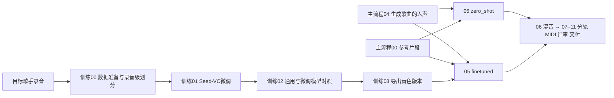

# 参考音色转换：零样本与目标音色微调

项目根目录：`/mnt/afs_f/liuhongda/music-cover-baseline`。以下命令都在该目录执行，并先设置 `export PATH="/opt/conda/bin:$PATH"`。

05 阶段提供两个独立入口，输出同一种 `converted.wav`，接入原来的 06–11 阶段。旧入口 `scripts/05_voice_conversion/run.sh` 保留，旧配置默认 `zero_shot`；已有运行显式保存的模式会继续沿用。想强制使用通用模型，请用 `zero_shot/run.sh`。

| 路线 | 命令入口 | 输入 | 是否训练 |
| --- | --- | --- | --- |
| 零样本 | `scripts/05_voice_conversion/zero_shot/run.sh` | 04 人声 + 00 参考录音 + 通用权重 | 否 |
| 微调模型推理 | `scripts/05_voice_conversion/finetuned/run.sh` | 同上 + 导出的 `voice.json` | 否 |
| 音色模型训练 | `scripts/05_voice_conversion/finetuned/training/00_prepare` 至 `03_export` | 目标歌手数据集，训练配置，独立验证素材 | 显式执行 01 时才训练 |



## 1. 文件结构

```text
scripts/05_voice_conversion/
├── run.sh                         # 兼容入口，默认零样本
├── zero_shot/run.sh                # 固定选择零样本
└── finetuned/
    ├── run.sh                     # 固定选择已微调模型
    └── training/
        ├── 00_prepare/run.sh      # 数据切片、质量统计、划分检查
        ├── 01_train/run.sh        # 微调与断点续训
        ├── 02_validate/run.sh     # 同输入对照、自动指标、盲听包
        └── 03_export/run.sh       # 只导出已验证 checkpoint
configs/voice_training/            # 正式模板与 smoke 示例
configs/tasks/voice_finetuned_sun_yanzi.yaml
configs/voice_training_assets.lock.json
src/music_cover/voice_training.py  # 训练流程控制和 attempt 记录
src/music_cover/voice.py           # 推理音色版本校验
src/music_cover/voice_weights.py   # 主模型参数覆盖校验
src/music_cover/backends/voice_train.py
src/music_cover/backends/voice_validate.py
src/music_cover/backends/voice_metrics.py
models/voices/<voice_id>/seed_vc/<version>/voice.json
```

`data/voice_datasets/`、`models/voices/` 和 `runs/` 均不提交 Git。训练数据、权重和大体积产物保留在服务器。

## 2. 环境与附加权重

先准备原有 Seed-VC 推理环境和基础模型，见 [模型权重指南](12_model_weights.md)。零样本 05 不需要下列训练和候选评估资源；若在 10 显式开启 voice_check，则仍需要 ECAPA。微调 05 的单候选和多候选均需要评估资源。

```bash
cd /mnt/afs_f/liuhongda/music-cover-baseline
export PATH="/opt/conda/bin:$PATH"

# 已有 seed-vc 环境上的附加依赖；保留现有 PyTorch/Transformers 版本。
envs/seed-vc/bin/python -m pip install --no-deps \
  -r configs/requirements-voice-adaptation.txt

# 显式下载训练和独立评估资产，固定 revision 和 SHA256。
envs/seed-vc/bin/python scripts/setup/setup_voice_training.py --scope all
# 已下载时只校验。
envs/seed-vc/bin/python scripts/setup/setup_voice_training.py --scope all --check-only
```

新增训练资产是 OpenVoiceV2 converter 和 Seed-VC `se_db.pt`；新增评估模型是 SpeechBrain ECAPA-TDNN。它们各自的用途、精确路径和固定版本见模型权重指南。本脚本不会从空白机器安装全部 CUDA/Python 环境。

## 3. 用 16 秒孙燕姿片段完成集成验证（历史配置，可重新准备）

配置：`configs/voice_training/sun_yanzi_seed_vc_smoke.yaml`。02 验证依赖 `validation.source_run`，请先按第 4 节创建该歌曲运行的 00–04；历史 `lhd_test_modular` 已清理。训练数据和已导出模型可能仍在，重新训练前请复制配置并换用新的 version/dataset_dir/export_dir/run。若只想使用已导出模型，直接看第 4 节。

- 训练源：`data/raw/references/sun_yanzi/reference.wav`，16 秒，切成两个 8 秒片段。
- 训练目录：`runs/voice_training/sun_yanzi_seed_vc_smoke_001`。
- 验证源：`runs/lhd_test_modular` 的 04 阶段人声和伴奏，取 40–52 秒、120–132 秒。
- 验证源歌曲为秋意浓，风格为 upbeat bossa nova / samba jazz。
- 当前目标音色素材不够独立划分训练、验证、测试和提示片段。因此显式标记 `smoke_test: true`，所有评估只证明集成可运行，不能证明未见歌曲上的音色效果改善。

```bash
# 00：把目标音色录音变成训练切片和清单。
bash scripts/05_voice_conversion/finetuned/training/00_prepare/run.sh \
  --config configs/voice_training/sun_yanzi_seed_vc_smoke.yaml \
  --run runs/voice_training/sun_yanzi_seed_vc_smoke_001

# 01：先执行 20 步，验证真实反向传播和 checkpoint 保存。
bash scripts/05_voice_conversion/finetuned/training/01_train/run.sh \
  --config configs/voice_training/sun_yanzi_seed_vc_smoke.yaml \
  --run runs/voice_training/sun_yanzi_seed_vc_smoke_001 --max-steps 20

# 01：恢复优化器、学习率调度器、随机数状态；累计到 40 步。
bash scripts/05_voice_conversion/finetuned/training/01_train/run.sh \
  --config configs/voice_training/sun_yanzi_seed_vc_smoke.yaml \
  --run runs/voice_training/sun_yanzi_seed_vc_smoke_001 --resume --max-steps 40

# 02：比较保存的候选 checkpoint 与通用模型。
bash scripts/05_voice_conversion/finetuned/training/02_validate/run.sh \
  --config configs/voice_training/sun_yanzi_seed_vc_smoke.yaml \
  --run runs/voice_training/sun_yanzi_seed_vc_smoke_001

# 03：导出验证选中的模型，供主流程 05 使用。
bash scripts/05_voice_conversion/finetuned/training/03_export/run.sh \
  --config configs/voice_training/sun_yanzi_seed_vc_smoke.yaml \
  --run runs/voice_training/sun_yanzi_seed_vc_smoke_001
```

上述目录用于 2026-10-26 的历史实测；若已执行过，不要把它当空目录从头训练。新一轮实验请复制 smoke 配置，修改 `version`、`dataset_dir`、`export_dir` 和命令中的 `--run`。续训使用 `--resume`，`--max-steps` 指累计步数；已达到的步数不能重复训练。导出版本不可覆盖。

| 阶段 | 实际使用的上游产物 | 查看结果 |
| --- | --- | --- |
| 训练00 | `data/raw/references/sun_yanzi/reference.wav` | `data/voice_datasets/sun_yanzi/smoke_v001/manifest.json` 和 `train/*.wav` |
| 训练01 | 00 的 manifest 和 train 切片 | 训练运行目录下 `loss.jsonl`、`checkpoints/step_000020.pth`、`step_000040.pth`、`latest.pth` |
| 训练02 | 01 checkpoint，主流程04 vocals/instrumental，目标参考 | `stages/02_validate/attempt_*/artifacts/validation.json`、`metrics.csv`、`listening.html`、`listening/`、`review_scores.csv` |
| 训练03 | 02 验证过且哈希一致的 checkpoint | `models/voices/sun_yanzi/seed_vc/smoke_v001/{voice.json,model.pth,config.yml,validation.json}` |

训练状态记录在训练运行目录的 `state.json`；每次尝试有 `config.json`、`command.json`、`process.log`、`outputs.json` 或 `failure.json`。查看 01 的 `artifacts/training.json` 可确认起止步数、参数更新、恢复状态和模型哈希。中间失败不会被记成成功。

## 4. 两个推理脚本分别怎样用

先用主流程 00–04 新建歌曲运行目录，例如 `runs/lhd_test_modular`；其历史数据已清理，不能直接跳到 05。两个入口都从这个目录的有效状态中读取：

- `04_vocal_separation/.../artifacts/vocals.wav`：要被转换的源人声。
- `00_prepare/.../artifacts/reference.wav`：目标音色提示。
- 微调入口额外读取 `voice.json` 指定的权重与配置，并校验 SHA256。

```bash
# 新建共同上游；已有有效结果时会校验复用。
cd /data/liuhongda/music-cover-baseline
export PATH="/opt/conda/bin:$PATH"

bash scripts/run_baseline.sh \
  --config configs/tasks/qiu_yi_nong_bossa_nova_sun_yanzi.yaml \
  --run runs/lhd_test_modular --until 04_vocal_separation

# 路线 A：通用模型，training-free。
bash scripts/05_voice_conversion/zero_shot/run.sh \
  --run runs/lhd_test_modular

# 路线 B：已导出的目标音色模型；此命令不会训练。
bash scripts/05_voice_conversion/finetuned/run.sh \
  --run runs/lhd_test_modular \
  --voice-profile models/voices/sun_yanzi/seed_vc/smoke_v001/voice.json

# 接着从 06 混音一路到最终交付，启用音色与 F0 评估。
bash scripts/run_baseline.sh \
  --run runs/lhd_test_modular --from 06_mix \
  --config configs/tasks/voice_finetuned_sun_yanzi.yaml
```

以上 A/B 在同一个歌曲运行目录顺序执行时各自产生不同 attempt，最后成功的 B 成为后续 06 的输入。需要把两套完整交付长期并排保存时，应使用不同歌曲运行目录。不要手动改 `stage_state.json`；依赖失效按提示从对应上游重新运行。

`/data/liuhongda/music-cover-baseline` 在当前服务器指向 `/mnt/afs_f/liuhongda/music-cover-baseline`。旧 v0.2 缓存记录了 Python 模块的入口路径；复用旧运行时沿用原入口别名，避免仅路径别名变化导致上游失效。新运行可以统一使用 `/mnt/afs_f/...`。

两个入口都输出 `stages/05_voice_conversion/attempt_*/artifacts/converted.wav`。`conversion.json` 记录模式、音色版本、主权重和配置哈希、源/参考哈希、推理步数、随机种子，以及 `training_performed: false`。模式或模型变化会让 05 及相关下游重新计算，00–04 仍可校验复用。

旋律调高由 02 管理；05 不再额外移调。微调后仍需目标参考片段，模型不会在缺少 profile 时偷偷切换回通用模型。

## 5. 正式训练数据与训练方式

复制 `configs/voice_training/sun_yanzi_seed_vc.yaml` 并填入 `sources`。示例（路径需替换为服务器上的实际干声录音）：

```yaml
smoke_test: false
sources:
  - {path: data/voice_datasets/raw/sun_yanzi/song_a.wav, group: song_a, split: train}
  - {path: data/voice_datasets/raw/sun_yanzi/song_b.wav, group: song_b, split: train}
  - {path: data/voice_datasets/raw/sun_yanzi/song_c.wav, group: song_c, split: validation}
  - {path: data/voice_datasets/raw/sun_yanzi/song_d.wav, group: song_d, split: test}
reference: data/voice_datasets/raw/sun_yanzi/prompt_e.wav
```

同一首歌、同一录音及其相邻切片必须归在同一 group，不能随机拆到不同集合。程序检查跨集合的重复文件哈希和 group；不同编码或裁剪版仍需正确标注 group。正式模式要求 train、validation、test，提示录音也必须独立。音频应是清楚的独唱干声，覆盖多个音区、元音、力度和唱法；程序只检查时长、有限数值、RMS 和削波比例，伴奏残留、混响和音色一致性仍需试听。

训练采用固定上游 Seed-VC 的音色扰动与条件流匹配目标：原目标歌手片段提供目标 Mel/F0/说话人条件；OpenVoice 随机改变输入音色，Whisper 提取内容，模型学习重建原目标音色。训练时更新 CFM/DiT 和 length regulator 的全部可训练参数；Whisper、CAMPPlus、RMVPE、OpenVoiceV2、BigVGAN 冻结。它不是把源歌曲加入目标歌手训练集，也不要求源/目标歌手配对演唱同一首歌。

本手册描述 Seed-VC 路线；另已接入独立 [so-vits-svc 歌手训练与转换](18_so_vits_svc.md)。[RVC 歌手训练与转换](20_rvc.md)也已接入；LoRA 尚未实现。验证时继续检查旋律、歌词清晰度、发音和自然度，不能以训练 loss 下降或某个音色指标提高替代人工判断。

正式训练按同样 00→01→02→03 命令执行，换成正式配置和新 run。先用 validation 选择 checkpoint，再对唯一选中的模型运行独立 test：

```bash
bash scripts/05_voice_conversion/finetuned/training/02_validate/run.sh \
  --config configs/voice_training/sun_yanzi_seed_vc.yaml \
  --run runs/voice_training/sun_yanzi_v001 \
  --evaluation-split test \
  --checkpoint runs/voice_training/sun_yanzi_v001/checkpoints/step_001000.pth
```

`step_001000.pth` 仅是路径示例，应替换成 validation.json 真正选中的 checkpoint。test 不允许一次排名多个候选。之后再 export，人工评审状态仍然是待评。

## 6. 指标与试听怎样解释

- `speaker_similarity`：独立 ECAPA 编码器的余弦相似度，不是“像某歌手的百分比”，且模型原本面向说话人识别，用于歌声仅作辅助。
- `speaker_similarity_delta`：在同一个源片段、目标参考、随机种子和推理步数下，微调结果减去通用模型结果。
- `pitch.status`：RMVPE F0 在延迟校正后的音高保持检查。`unassessable` 表示片段/对齐/有效帧不足等，不等同于成功。
- 验证优先从音高检查通过的候选中按平均音色相似度增量选择。若没有通过者，只保留对照结果，拒绝导出。
- `listening.html` 含源干声、目标参考、随机 A/B 干声与同伴奏混音。混音统一对齐并按源 RMS 配平；A/B 干声保留原推理输出。身份表在 `listening_key.json`，评审时先不要看。
- 训练验证包保留每个候选的音频、模型哈希、F0、指标和评分表。评审人应另存填写后的评分表，保留原始产物。
- 主流程 10 的 `voice_check: true` 会额外生成 `voice_conversion_evaluation.json` 与 F0 诊断，即使 `transpose=0` 也执行。这使用主流程同一提示录音，仅是运行诊断。原来的整曲评审和分轨/MIDI 仍保留。

2026-10-26 的训练、续训、对照和整曲验证历史记录见 [验证记录](14_voice_adaptation_validation.md)。

## 微调推理的三个候选

微调入口默认生成三个完整候选（seed=42 时为 42、43、44），使用同一目标音色模型、源人声、参考片段和推理参数。05 保存干声与逐项指标，06 分别混音，11 交付三个 WAV/MP3。仅技术检查合格的候选参与 ECAPA 排名，推荐版本进入分轨、MIDI 和最终交付入口；零样本入口仍为单次推理。

具体命令与中间文件路径见[三个候选与推荐结果使用说明](15_voice_candidates.md)。
