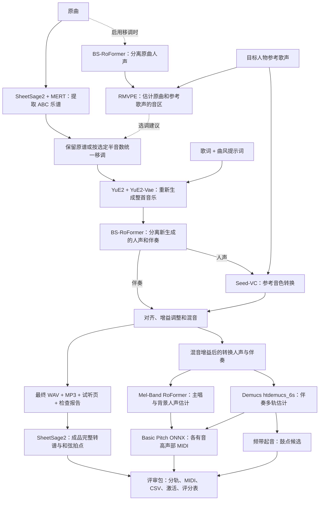

> 历史存档，保留当时的设计与验证记录。路径可能已清理，不作为当前操作手册。当前入口见 [使用说明](../../USAGE.md)。

音乐换曲风与参考音色转换 Baseline 技术报告（v0.1，2026-10-23）

本文是 v0.1 历史路线报告，包含后来补充的选调说明；当前版本为 v0.3，零样本与微调双入口见 [音色手册](../13_voice_adaptation.md)，当前验证见 [v0.3 实例](../17_v03_walkthrough.md)。历史单一路线及旧运行不代表当前全部功能。逐步运行见 [00–11 实操手册](../11_modular_walkthrough.md)，版本变化见 [CHANGELOG.md](../../CHANGELOG.md)。

2026-10-23 模块化说明：本文保留 v0.1 的模型路线与历史验证。当前代码已按 12 个阶段拆分，独立入口、产物契约和续跑方式以 [模块化文档](../09_modular_pipeline.md) 为准；本文历史运行路径不迁移。

v0.1 已经跑通“原曲转谱 → 按目标曲风重新生成 → 分离人声与伴奏 → 参考歌声换音色 → 对齐混音 → 成品分轨与 MIDI 评审”的完整流程，支持可选的音区分析与谱面移调。核心生成模型为 YuE2，换声模型为 Seed-VC；使用现成预训练权重，不需要针对目标人物另行训练。`v0.1` 默认输出 WAV、MP3、分轨音频、MIDI、音符 CSV 和人工评审资料。

本报告依据 2026-10-23 的代码、锁定的模型配置以及当时已完成运行的产物整理。这里的“跑通”表示推理和工程检查成功；曲风符合程度、歌词准确度、目标音色相似度和自然度仍需听感验收。本次报告整理未重新生成音频，也未进行人工听感验收。

项目位于 `/data/liuhongda/music-cover-baseline`，统一入口是 `scripts/run_baseline.sh`，操作方法见 [USAGE.md](../../USAGE.md)。

完整路线如下，其中音区分析和谱面移调仅在启用 `--transpose` 时执行：

各模型在当前实现中的作用如下：

| 模型或权重 | 当前用途 | 输出或作用 |
| --- | --- | --- |
| MERT-v2-FullSong | SheetSage2 的音乐特征编码器 | 从原曲提取音乐表征 |
| SheetSage2 | 音频转谱 | 为 YuE2 提供 ABC 格式的旋律条件 |
| YuE2-3B | 按乐谱、歌词和风格提示词生成音乐 | 重新生成目标曲风的演唱和编曲 |
| YuE2-Vae | YuE2 音频解码器 | 将生成的声学表示解码为音频 |
| BS-RoFormer | 音源分离 | 分离人声与伴奏；启用选调时也用于分离原曲人声 |
| Seed-VC，44.1 kHz、F0 条件歌唱转换权重 | 参考录音驱动的零样本换声 | 将新生成的演唱转换为接近参考人物的音色 |
| RMVPE | 基频 F0 提取 | 用于音区分析、Seed-VC 音高条件及结果检查 |
| Whisper-small 编码器 | Seed-VC 内容编码 | 提取待转换歌声的内容表征；主流程中不负责准备歌词 |
| CAMPPlus | Seed-VC 参考音色编码 | 从参考录音提取说话人/音色表征 |
| BigVGAN v2，44.1 kHz | Seed-VC 声码器 | 将预测的声学特征转换为人声音频 |
| Mel-Band RoFormer karaoke | 对转换后的人声再次分离 | 主唱估计及其余背景人声；不保证是真实独立和声 |
| Demucs htdemucs_6s | 对最终混音中的伴奏进行分离 | 鼓、贝斯、吉他、钢琴、其他乐器和伴奏内人声残留 |
| Basic Pitch 0.4.0 ONNX | 对各有音高声部转谱 | MIDI、音符 CSV、原始 MIDI 与模型激活，使用 CPU |

当前分离权重为 `model_bs_roformer_ep_317_sdr_12.9755.ckpt`。Seed-VC 歌唱权重为 `DiT_seed_v2_uvit_whisper_base_f0_44k_bigvgan_pruned_ft_ema_v2.pth`；实际本地内容编码配置使用 Whisper-small，不能仅依据权重文件名判断辅助模型版本。FFmpeg 用于音频解码、裁剪和重采样，不是生成模型。

模型来源及 revision 记录在 [generation_models.lock.json](../../configs/generation_models.lock.json)、[voice_models.lock.json](../../configs/voice_models.lock.json) 和 [separation_model.lock.json](../../configs/separation_model.lock.json)。上游路线说明可参考 [YuE 官方仓库](https://github.com/multimodal-art-projection/YuE) 与 [Seed-VC 官方仓库](https://github.com/Plachtaa/seed-vc)。

评审模型的 URL、实测 SHA256 与依赖版本另见 [review_models.lock.json](../../configs/review_models.lock.json)。源代码固定在 Git；大模型权重和生成数据不上传仓库。

当前实现有三个关键设计选择。

第一，换曲风通过“乐谱作为中间表示”完成。SheetSage2 从原曲提取旋律谱，YuE2 接收该乐谱、歌词和新风格提示词，重新演唱并生成伴奏。当前使用旋律条件，给新编曲留下调整空间。因此它是受原曲旋律约束的重新生成，不能保证原曲波形、每个音符、演唱节奏和总时长完全不变。转谱误差也可能传递到生成阶段。对应实现见 [YuE2 后端](../../src/music_cover/backends/yue.py)。

第二，换音色采用参考录音驱动的 Seed-VC。v0.1 尚无目标人物专用模型，因此采用通用权重；v0.3 已增加 Seed-VC 目标音色微调。当前新增了独立 so-vits-svc 歌手训练及转换入口，见 [SVC 指南](../18_so_vits_svc.md)；RVC 已作为额外歌手训练与转换入口接入，见 [RVC 指南](../20_rvc.md)。没有调用 Suno。本节历史结果使用 Seed-VC。Seed-VC 使用通用预训练模型，结合参考音色、待转换内容和音高条件合成新歌声。当前使用 30 步推理，开启 F0 条件，长度系数为 1.0；关闭自动 F0 调整，额外半音偏移为 0。目标是尽量保持 YuE2 已生成的旋律与时间轴，再改变音色。

第三，音区适配模块已经升级为双向选调 v2。启用 `--transpose auto` 后，使用 RMVPE 原曲人声与参考歌声的 P10～P90 分位数分布，在默认 -6～+6 整数半音中比较匹配距离和移调幅度，并用时间块重采样评估方向稳定性。参考须明确为 singing；不足或不稳定时保留原调并记录原因。不会把短片段高音推断为歌手硬上限。手动支持 -12～12，默认关闭分析。配置、报告和生成后音高核验见 [双向选调说明](../10_bidirectional_pitch.md)。

移调在 YuE2 生成之前修改乐谱，统一调整人声及器乐旋律声部、调号，并检查音符起点、时值、节拍和速度保持不变。YuE2 据此生成同调的演唱和伴奏，随后 Seed-VC 不再额外移调。当前自动策略可能选择 0；它不是每首男声歌曲都固定升调。选调实现见 [pitch_selection.py](../../src/music_cover/pitch_selection.py)，谱面移调见 [pitch.py](../../src/music_cover/pitch.py)。

运行需要的输入及现有素材如下：

| 输入 | 项目位置 | 当前要求或状态 |
| --- | --- | --- |
| 原曲 | `data/raw/songs/` | 现有服务器含《落叶归根》《秋意浓》《喜欢你》等测试素材，不随 Git 分发 |
| 歌词 | `data/raw/lyrics/` | UTF-8 文本，可接受 LRC；歌词顺序应与歌曲匹配 |
| 参考录音 | `data/raw/references/` | 建议单人、清晰的 10～20 秒歌声 |
| 风格描述 | 命令行 `--style` | 描述曲风、乐器、节奏及演唱方式 |

当前孙燕姿参考是从歌曲中分离出的约 16 秒人声，路径为 `data/raw/references/sun_yanzi/reference.wav`。詹姆斯参考以说话为主，可以用于换声尝试，但不适合用来推断歌唱音区。主推理脚本只裁剪、重采样参考音频，不会自动给任意参考录音分离伴奏；新的带伴奏参考应先独立处理。

早期完成的两个代表性运行如下。相关运行目录已清理，保留的是历史测量记录；当时不包含当前默认的评审阶段。目标音色一栏表示所用参考，曲风一栏表示生成目标，并不等同于已经通过人工验收。

| 原曲 | 目标曲风 / 参考音色 | 自动移调 | 最终时长 | 成功流程耗时 |
| --- | --- | --- | --- | --- |
| 《落叶归根》 | 现代爵士摇滚融合 / 孙燕姿歌声 | +3 半音，Ab → B | 307.28 秒，约 5 分 7 秒 | 262.84 秒，约 4 分 23 秒 |
| 《秋意浓》 | 乡村抒情 / 孙燕姿歌声 | 0 半音，Am → Am | 390.96 秒，约 6 分 31 秒 | 294.39 秒，约 4 分 54 秒 |

以上是本机单张 H200 按阶段串行推理的记录，包含阶段进程启动和模型加载，不含首次安装下载、先前失败尝试及附加评价。当前 YuE2 显存预算配置为 80 GiB，这不是实测峰值，也不构成最低硬件要求结论。

《落叶归根》移调前后，换声前歌声的全曲 F0 中位数由 236.75 Hz 变为 282.63 Hz，约提升 3.07 个半音；最终歌声 30～60 秒窗口的中位数由 165.21 Hz 变为 206.28 Hz，支持开头歌声音区上移。两次生成的节奏和时长不同，这些统计不能视为逐音移调精度，也不能证明粗糙感已经消除。详见 升调运行报告（历史路径：`../runs/20261022_022204_luo_ye_gui_gen_sun_yanzi_pitch_adapted_15e6f1/deliverables/report.md`）。

《秋意浓》已完成从转谱到混音的全部阶段。此前长曲生成截断的问题已通过按乐谱时长分配生成 token 上限处理，本次实际使用 12000 个语义 token 上限并正常结束；该上限提供约 8 分钟容量，不要求生成满 8 分钟。脚本仍会拒绝截断结果以及超出上下文容量的请求，不保证任意长度歌曲都能生成。详见 秋意浓运行报告（历史路径：`../runs/20261022_024637_qiu_yi_nong_country_sun_yanzi_e60edb/deliverables/report.md`） 和 实际生成预算（历史路径：`../runs/20261022_024637_qiu_yi_nong_country_sun_yanzi_e60edb/02_cover/attempt_002/generation_budget.json`）。

每次运行交付目录为 `runs/<运行编号>/deliverables/`。最终混入的是 YuE2 新生成并分离出的伴奏。混音前进行固定延迟校正、长度检查及增益调整，输出 48 kHz、立体声、24 bit WAV，并从该 WAV 编码生成 192 kbps MP3。

当前新增评审功能已在两首完整歌曲上执行：《秋意浓》Synthwave / Dance-pop 输出 396.998667 秒，《喜欢你》Bossa Nova / Samba Jazz 输出 269.838667 秒，均使用孙燕姿参考歌声并自动选为 0 半音。两份评审包各有 12 条音轨和 10 个主 MIDI 文件；《喜欢你》在 2026-10-23 独立复核了 122 个文件，哈希、重建、MIDI 时间范围、ZIP 和页面链接检查通过。上传前 22 项单元测试和环境预检通过；详见 [VALIDATION.md](../../VALIDATION.md)。

| 验收文件 | 用途 |
| --- | --- |
| `final.wav` | 最终音乐 |
| `final.mp3` | 最终音乐的 192 kbps 压缩版，便于下载和分享 |
| `listen.html` | 原曲、参考音色、中间结果和最终结果的试听入口 |
| `restyled.flac` | 先验收 YuE2 的旋律、歌词和风格 |
| `vocals_before.wav` / `vocals_after.wav` | 比较换声前后的人声 |
| `instrumental.wav` / `reconstruction.wav` | 检查伴奏及分离、重混损伤 |
| `report.md` / `checks.json` | 耗时、音频格式、长度、对齐、峰值等记录 |
| `transposition.json`、前后 ABC 谱和音高报告 | 启用移调时检查选调依据、谱面修改及实际音高 |
| `review/index.html`、`review/audio/` | 转换后分轨试听；包括父轨、叶轨及残差 |
| `review/midi/`、`review/midi_bundle.zip` | 各声部、合并编曲、鼓点候选和和弦指南 |
| `review/final_transcription/`、`review/source_transcription/` | 成品与输入原曲分别转谱，时间线可能不同 |
| `review/notes/`、`review/raw_midi/`、`review/activations/` | 音符表、原始转谱和模型激活 |
| `review/review_scores.csv`、`review/excerpts/`、`review/audio_comparison.json` | 人工评分空表、试听片段与描述性指标 |
| `review/stems.json`、`review/midi.json`、`review/manifest.json` | 数据来源、参数、限制和文件校验值 |

评审轨道应用最终混音增益后导出为 48 kHz 立体声 32-bit float，统一起点和采样点长度，不逐轨归一化。总人声和总伴奏是父轨；只将 `stems.json` 的 `leaf_sum_roles` 相加才可重建最终混音，父轨不能再次叠加。残差不是乐器，小重建误差不是分离质量评分。

MIDI 来自转换后的音频重新转谱。主文件使用 120 BPM 固定时间刻度保存绝对秒数，不代表估计歌曲速度为 120 BPM，也未做节拍量化；拍点另存 `beat.lab`。`harmony.mid` 是和弦指南，鼓轨是低／中／高频起音的 GM 36／38／42 候选映射，均需人工修订。`arrangement_estimate.mid` 合并各叶声部，不重复加入总人声和和弦指南。

默认启用评审；`--no-review` 可关闭新增阶段。音轨、激活和中间数据会增加数 GB 磁盘占用，旧基础流程耗时不能代表当前完整运行耗时。

工程层面已经支持模型环境隔离、分阶段日志、输入和产物哈希、失败恢复，以及在依赖未变化时复用已完成阶段。模型与配置可追溯，但这些记录不能代替音乐质量评价。相关实现见 [pipeline.py](../../src/music_cover/pipeline.py)。

目前仍有以下限制：

- 参考片段的音区、发声方式和清洁程度会影响换声。约 16 秒参考无法覆盖完整歌唱表现，音色相似度尚无统一验收结论。
- YuE2 是重新生成，可能改变演唱节奏、歌词和旋律细节；当前流程不保证逐词或逐音忠实。
- 分离可能残留原人声、和声或混响，这些成分贴回伴奏后会影响目标音色。
- 已有升调结果的前奏在换声后检测到少量新增有声帧，提示可能存在额外声响；升调模块没有解决无歌声段的换声噪音。
- 自动选调支持升降调，但短参考只支持样本音区匹配；高音自然度和低音粗糙度仍需分别试听。
- 当前速度来自单机实测，缺少跨硬件性能评测及覆盖多首歌曲、多个目标人物的系统听感评价。
- 背景人声可能含混响或分离伪影；钢琴、吉他等文件存在不代表该乐器真实存在。自动 MIDI 可能漏音、多音、错八度，不能当作人工乐谱。
- 《秋意浓》Synthwave 的附加 Whisper 检查出现高 CER 和大量重复，已标记待听音；技术检查通过不代表歌词或语言表现达标。《喜欢你》本次仅进行文件和工程验证，未补跑 ASR 或人工听音。

下一步可优先补充多个干净歌唱参考片段、处理无歌声区间的换声输出，并建立固定歌曲集的分阶段听感对照。这些是后续建议，尚未作为当前 baseline 的已实现能力。
